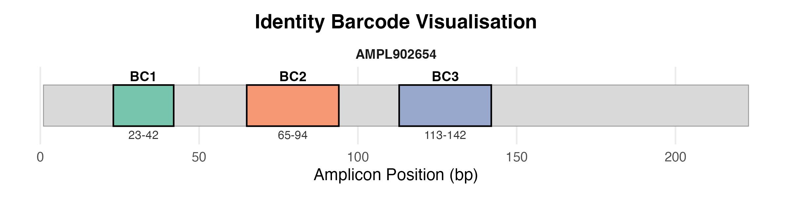
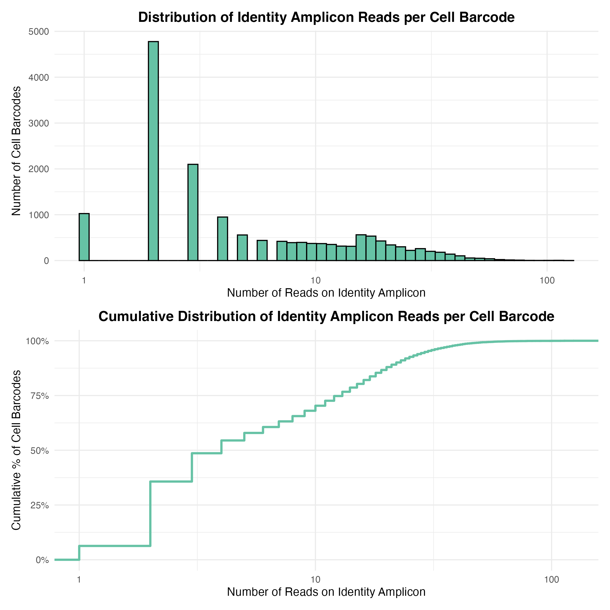
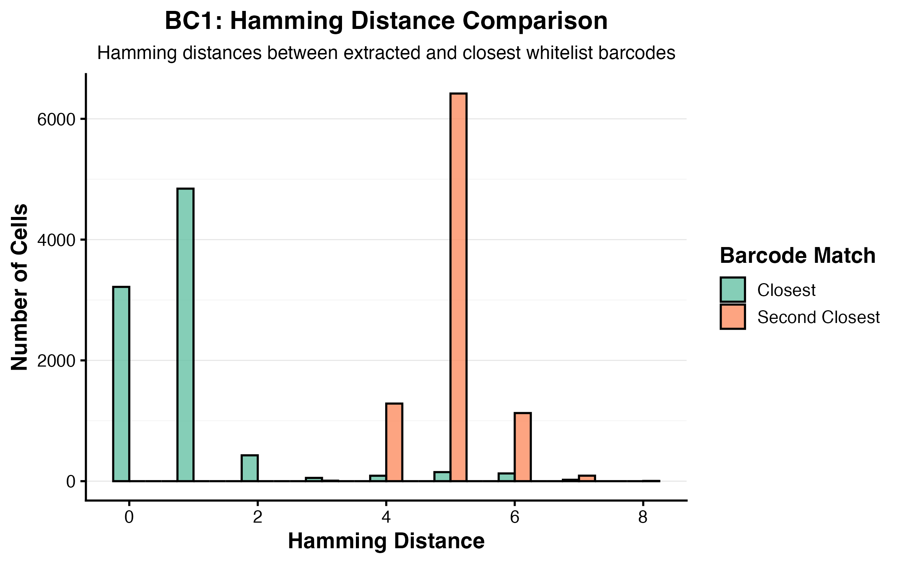
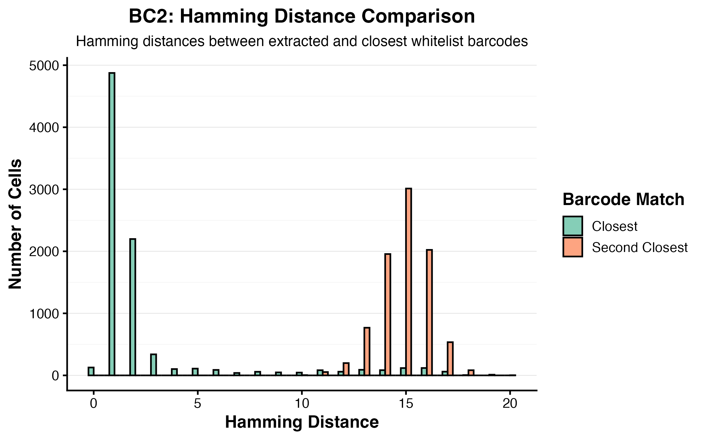
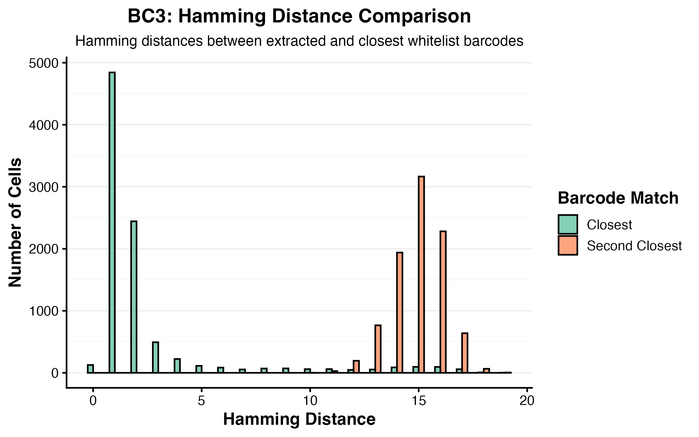
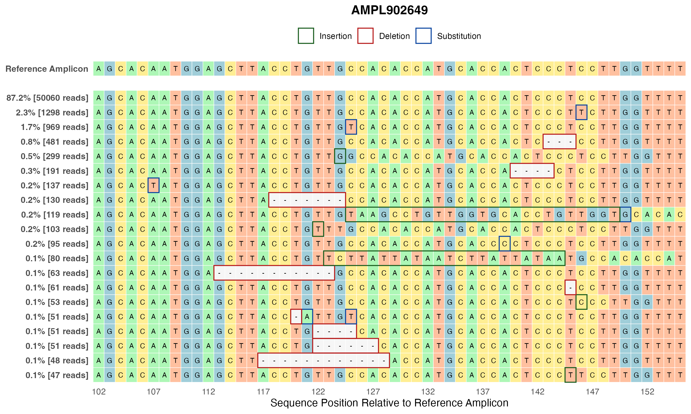
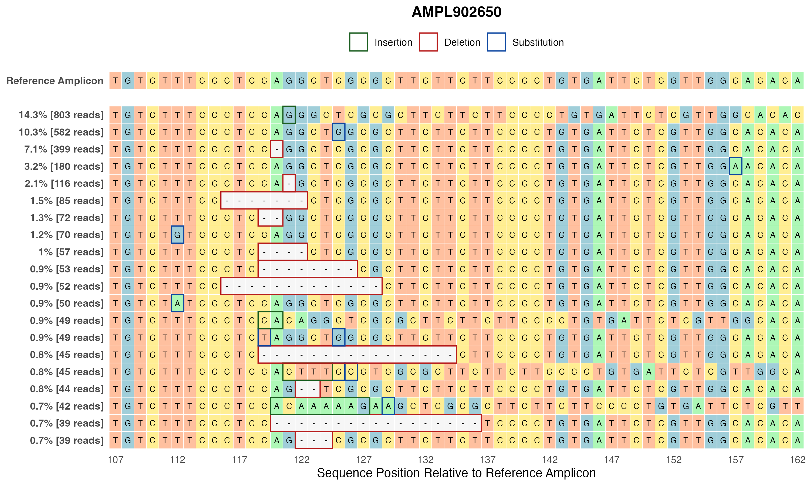
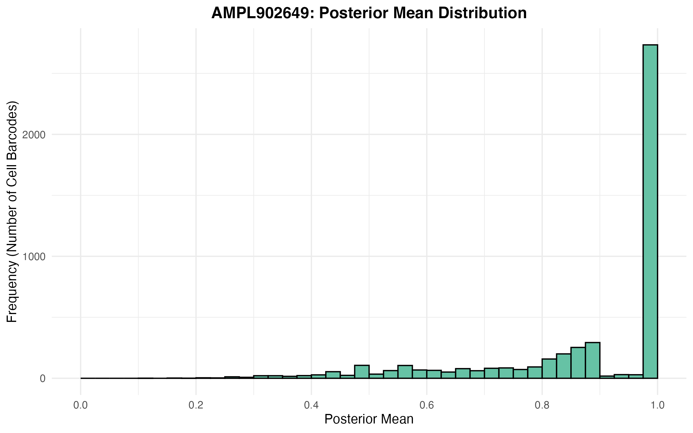
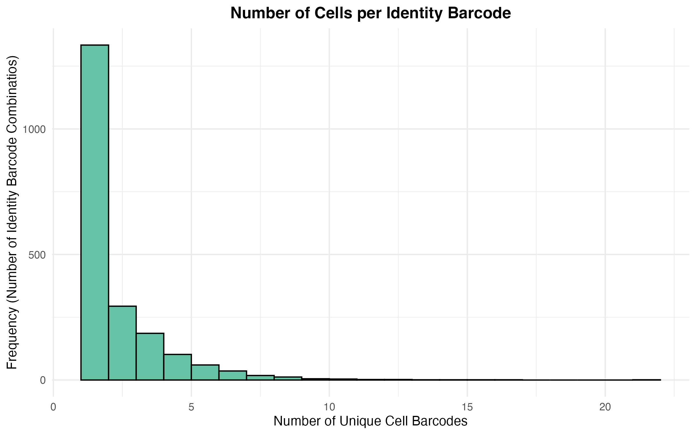

## Data Structure

Below is an overview of how your output data from the Nextflow package (as well as your whitelist barcode files) should be laid out in your working directory:

**Note**: There *may* at times be disagreement between the output file names from `scFindEd-nf` and the below expected file names. We will strive to ensure this is not the case. If any file names do differ, please rename the files to match the below file name structures.

```{r, eval=FALSE}
your_data/ 
  ├── fragment_mutations/ 
  │     ├── {sample_name}_{AmpID}_fragment_mutations.tsv.gz
  │     ├── {sample_name}_{AmpID}_fragment_mutations.tsv.gz
  │     ├── ...
  │     ├── {sample_name}_{AmpID}_fragment_mutations.tsv.gz
  │     └── {sample_name}_{AmpID}_fragment_mutations.tsv.gz
  │
  ├── {sample_name}_{identity_AmpID}_reads.tsv.gz 
  │
  ├── {panel_ID}_design_summary_joined.csv
  │
  ├── ref_amplicons_sorted.fa
  │
  ├── {BC1_whitelist_file_name}
  ├── {BC2_whitelist_file_name}
  ├── {BC3_whitelist_file_name}
  └── ... # etc. for however many barcodes are in your identity barcode system
```

**Important Note**: In order to bring `scFindEd` inline with `scFindEd-nf`, and to create a standardised term that covers UTR barcodes, guides and peg barcodes, the terms `identity_barcode` / `identity_AmpID` / `identity_amplicon` will be used throughout to describe lineage-tracing barcodes and/or amplicons.

All files except for `BC1_whitelist_file_name`, `BC2_whitelist_file_name` etc. should be produced by the Nextflow, and therefore should have standardised data structure. `BC1_whitelist_file_name`, `BC2_whitelist_file_name` etc. should be `.csv` files with the following structures:

```{r, eval=FALSE}
{BC1_whitelist_file_name} e.g. "75K_barcode.csv"

identity_barcode_1A
identity_barcode_1B
identity_barcode_1C
identity_barcode_1D
...


{BC2_whitelist_file_name} e.g. "BC2_whitelist_barcodes.csv"

identity_barcode_2A
identity_barcode_2B
identity_barcode_2C
identity_barcode_2D
...
```

**Note**: Each identity barcode requires its own barcode whitelist. Each whitelist is the complete list of individual barcodes that could be at that barcode position.


## Barcoding

### extract_identity_barcode_info()

This function is short and simple. It takes the `ref_amplicons_sorted.fa` file produced by`scFindEd-nf` and extracts identity barcode information based upon the sequence(s) of `N`s in the DNA sequence for the provided `identity_AmpID`. 

It requires the `ref_amplicons_sorted.fa` file, which can be found in the `reference_amplicon/` directory of the `scFindEd-nf`'s output.

**Output**: If `output_dir` is defined, the function exports a table describing the `start` position, `length` and `end` position for each barcode in the identity amplicon (`{sample_name}_identity_barcode_info.csv`). If `plots_output_dir` is defined, this function will also produce a visualisation of the identity barcodes' structure across the identity amplicon(s) (`{sample_name}_identity_barcode_visualisation.png`). This should allow the user to confirm that the identity barcode structure the package will operate with matches the user's planned design.

**Note**: `identity_AmpID` may contain either a string pointing to an amplicon ID, or a character vector containing several strings that point to amplicon IDs.

```{r, eval=FALSE}
extract_identity_barcode_info(source_dir = "data",
                              sample_name = "scSNV_example",
                              identity_AmpID = "AMPL123456",
                              output_dir = "data",
                              plots_output_dir = "plots",
                              verbose = TRUE)
```




### evaluate_optimal_barcode_flanks()

This function takes the extracted identity barcode information (`{sample_name}_identity_barcode_info.csv`), as well as the de-multiplexed reads data for the identity amplicon (`{sample_name}_{identity_AmpID}_reads.tsv.gz`), in order to determine the best choice of flank for each identity barcode.

The best choice of flank is determined as the flank that will retain the most reads downstream. To clarify, in `process_identity_barcodes()`, if the flank is identified more than once in a read, that read is discarded. Therefore, the optimal flank is the flank which is identified exactly once in the most reads.

**Output**: If `output_dir` is defined, the optimal flank (flank size, orientation: forward/reverse read, direction: upstream/downstream) is suggested in the console and is also added to the existing `{sample_name}_identity_barcode_info.csv` file. Summary stats for each possible flank are also saved to their respective `{sample_name}_BC{barcode_ID}_flank_stats.csv` files.

**Note**: After running this function, if you would like to select a different flank, simply update the information that is saved in `{sample_name}_identity_barcode_info.csv`.

**Note**: `identity_AmpID` may contain either a string pointing to an amplicon ID, or a character vector containing several strings that point to amplicon IDs.

```{r, eval=FALSE}
evaluate_optimal_barcode_flanks(source_dir = "data",
                                sample_name = "scSNV_example",
                                identity_AmpID = "AMPL123456",
                                min_reads = 2, # Minimum number of reads required for each cell barcode
                                min_flank_size = 5,
                                max_flank_size = 18,
                                output_dir = "data",
                                verbose = TRUE) 
```


### process_identity_barcodes()

This function requires the de-multiplexed reads data for the identity amplicon (`{sample_name}_{identity_AmpID}_reads.tsv.gz`), as well as the evaluated `{sample_name}_identity_barcode_info.csv` file. It extracts each of the barcodes listed in this information file by locating the selected flanks, before grouping cells by cell barcode and counting reads. 

The function is completely flexible to barcode number and flank length/direction/read orientation.

**Output**: If `output_dir` is defined, the function exports a table linking cells to extracted barcodes (`{sample_name}_cell_to_extracted_BCs.csv`). If `plots_output_dir` is defined, this function will also export a paired quality control plot that summarises the reads per cell barcode (`{sample_name}_barcode_combination_plots.png`).

**Note**: `identity_AmpID` may contain either a string pointing to an amplicon ID, or a character vector containing several strings that point to amplicon IDs.

```{r, eval=FALSE}
# Example function call
process_identity_barcodes(source_dir = "data",
                          sample_name = "scSNV_example",
                          identity_AmpID = "AMPL123456",
                          min_reads = 2, # Minimum number of reads required for each cell barcode
                          output_dir = "data",
                          verbose = TRUE) 
```




### identify_whitelisted_barcodes()

This function identifies the three whitelist barcodes with the shortest Hamming distances between them and the extracted barcodes, for each of the barcodes in the identity barcode system. 

**Output**: If `output_dir` is defined, this function exports an `.RDS` list of the shortest distance whitelist barcodes for each of the identity barcodes in the experiment (`{sample_name}_BC{BC_ID}_closest_barcodes.rds`). If `plots_output_dir` is defined, it also produces a Hamming distance-based quality control plot for each identity barcode, showing the distributions of distances between the extracted barcodes and the first and second closest whitelist barcodes (`{sample_name}_BC{BC_ID}_hamming_plot.png`). These plots can be used to select appropriate values for `BC_thresholds`, used in `assign_identity_barcodes()`; you would like to select a large-enough Hamming distance that still ensures no second-closest barcodes are assigned.

**Note**: Due to the large character matrices this function utilises (comparing millions of reads against potentially thousands of whitelist barcodes), this step of the function has been (1) batched to prevent memory overflow and (2) parallelised to improve processing speed. Adjust `n_threads` to make optimal use of your computer's / compute farm's available processing cores.

```{r, eval=FALSE}
# Example function call
identify_whitelisted_barcodes(source_dir = "data",
                              sample_name = "scSNV_example",
                              whitelist_barcode_files = list(
                                BC1 = "BC1_whitelist_barcodes.csv",
                                BC2 = "BC2_whitelist_barcodes.csv",
                                BC3 = "BC3_whitelist_barcodes.csv"
                              ),
                              n_threads = 4,
                              output_dir = "data",
                              plots_output_dir = "plots",
                              verbose = TRUE)
```








### assign_identity_barcodes()

This function begins by correcting identity barcode combinations by applying Hamming distance-based threshold correction (if the distance between the extracted barcode and the closest whitelist barcode is below the provided threshold - correct the extracted barcode). It then assigns cells an identity barcode combination as follows: an identity barcode combination is assigned to a cell if and only if there are at least `min_reads` reads of that barcode combination in the cell, and they constitute more than `min_reads_proportion` of the barcode reads in that cell.

**Output**: If `output_dir` is defined, this function exports a file containing all cell-to-identity barcode combination assignments - the 'barcode system' (`{sample_name}_barcode_system.csv`).

```{r, eval=FALSE}
# Example function call
assign_identity_barcodes(source_dir = "data",
                         sample_name = "scSNV_example",
                         BC_thresholds = list(BC1 = 3, 
                                              BC2 = 5,
                                              BC3 = 5),
                         reads_thresholds = list(min_reads = 5,
                                                 min_reads_proportion = 0.9),
                         output_dir = "data",
                         verbose = TRUE)
```


## Genotyping

### summarise_variants()

This function calculates the codes for both the R1 and R2 reads on each amplicon for each mutation in HGVSc nomenclature (e.g. `"c.{pos}{ref}>{alt}"`), using the data provided in the amplicon's read fragments file. It exploits read `pos`, `cigar`, `nm`, `md` and `seq` information to determine a single code that describes the difference between each read and the reference amplicon.

The two HGVSc codes are then merged, as long as they are concordant across the region that they paired reads overlap, to produce a single code that describes a unique variant. These variants are then collapsed per cell barcode. If `barcoded = TRUE`, the cell barcode is subsequently matched to its corresponding identity barcode combination (using `{sample_name}_barcode_system.csv`).

**Output**: If `output_dir` is defined, this function exports the variant summary file for each amplicon (`{sample_name}_{AmpID}_variant_summary.tsv`).

**Note**: The design summary file is expected to have the following name structure: `{panel_ID}_design_summary_joined.csv`. If yours does not, for now edit the file name to match this structure (including `{panel_ID}`) and use that as that value for the argument `panel_ID`.

```{r, eval=FALSE}
# Example function call
summarise_variants(source_dir = "data",
                   sample_name = "scSNV_example",
                   panel_ID = "9876",
                   barcoded = TRUE, # Tells the function whether your experiment uses identity barcodes
                   output_dir = "data",
                   verbose = TRUE)
```


### identify_true_mutations()

This function is used to trim the 'noisy' mutations from each variant, returning variant codes that contain only the likely 'true' mutations. Here, a 'noisy' mutation is one that appears in less than `true_mutation_proportion` of the reads in each cell. The idea is to filter out noise mutations from variant codes, assumed to be sequencing errors rather than somatic mutations, allowing the reads to be collapsed down further (useful for generating counts of read variants).

This function also filters variants for a minimum number of reads per cell `min_reads`, and if `barcoded = TRUE`, for a minimum number of cells per identity barcode combination - `min_cells`.

**Output**: If `output_dir` is defined, exports the true mutations summary file for each amplicon (`{sample_name}_{AmpID}_true_mutations.tsv`).

**Note**: The design summary file is expected to have the following name structure: `{panel_ID}_design_summary_joined.csv`. If yours does not, for now edit the file name to match this structure (including `{panel_ID}`) and use that as that value for the argument `panel_ID`.

**Note**: If `min_reads < 10`, then instead of using `true_mutation_proportion`, mutations will only be retained if they appear in strictly more than one read. This is to prevent the system from not operating as intended with small values of `true_mutation_proportion` (such as the default value of `0.1`).

```{r, eval=FALSE}
# Example function call
identify_true_mutations(source_dir = "data",
                        sample_name = "scSNV_example",
                        panel_ID = "9876",
                        min_reads = 10,
                        true_mutation_proportion = 0.1,
                        barcoded = TRUE, # Tells the function whether your experiment uses identity barcodes
                        min_cells = 1,
                        output_dir = "data",
                        verbose = TRUE)
```


### strip_mutations()

This function is used to trim out certain mutations from each variant, specifically those that were not removed during the function `identify_true_mutations()`. The most probable reason for doing so would be to remove a common, benign variant from each variant it occurs in, in order to reconsider the reads as wildtype at that base position. This can make it easier to call consistent genotypes downstream.

The user is required to provide a specific `AmpID` from which variants will be stripped from, as well as a single character or character vector of `mutations` that should be stripped.

**Output**: If `output_dir` is defined, re-exports the true mutations summary file for the specific `AmpID` (`{sample_name}_{AmpID}_true_mutations.tsv`).

```{r, eval=FALSE}
# Example function call
strip_mutations(source_dir = "data",
                sample_name = "MB_barcoded",
                AmpID = "AMPL123456",
                c("c.100A>G", "c.110C>G"),
                output_dir = "data",
                verbose = TRUE)
```


### plot_variant_summary()

This function is used to visualise the distribution of variants across a sample. It can be used to generate plot(s) for all variants in each amplicon, or in a specific amplicon. It can also be used to generate plot(s) for all variants that belong to a specific cell barcode / identity barcode combination, also for either every amplicon or a specific amplicon.

This behaviour is determined by whether an amplicon ID is provided to `amplicon` or left `NULL`, and whether a cell barcode / identity barcode combination is provided to `barcode` or left `NULL`.

**Output**: If `output_dir` is defined and a `barcode` is provided, a directory named `{barcode}/` is created in `{output_dir}/` and plots are saved there. Otherwise, plots are saved in `{output_dir}/`. The plot files are named `{amplicon}_variant_summary.png`

**Note**: Currently we have *commented out* a chunk of code that removes the wild-type variant from whole-amplicon summary plots. This was commented out as it gave a distorted view of counts for all other variants; the trade-off is that the variant frequency percentages on the left of the plot are substantially deflated.

```{r, eval=FALSE}
# Example function call - prints bulked variant summary for every amplicon
plot_variant_summary(source_dir = "data",
                     sample_name = "scSNV_example",
                     panel_ID = "9876",
                     # amplicon = "AMPL123456",
                     # barcode = "cell_barcode_A", # Or "identity_barcode_A"
                     output_dir = "plots",
                     verbose = TRUE)
```

```{r, eval=FALSE}
# Example function call - prints bulked variant summary for specific amplicon
plot_variant_summary(source_dir = "data",
                     sample_name = "scSNV_example",
                     panel_ID = "9876",
                     amplicon = "AMPL123456",
                     # barcode = "cell_barcode_A", # Or "identity_barcode_A"
                     output_dir = "plots",
                     verbose = TRUE)
```

```{r, eval=FALSE}
# Example function call - prints barcode-specific variant summary for every amplicon
plot_variant_summary(source_dir = "data",
                     sample_name = "scSNV_example",
                     panel_ID = "9876",
                     # amplicon = "AMPL123456",
                     barcode = "cell_barcode_A", # Or "identity_barcode_A"
                     output_dir = "plots",
                     verbose = TRUE)
```

```{r, eval=FALSE}
# Example function call - prints barcode-specific variant summary for specific amplicon
plot_variant_summary(source_dir = "data",
                     sample_name = "scSNV_example",
                     panel_ID = "9876",
                     amplicon = "AMPL123456",
                     barcode = "cell_barcode_A", # Or "identity_barcode_A"
                     output_dir = "plots",
                     verbose = TRUE)
```






### genotype_cells()

This function is used to assign a 'most-probable genotype' for every `cell_barcode` in each amplicon of an experiment. It applies a Dirichlet multinomial model and determines the variant in each cell that is the most-probable to be the 'genotype'. Currently, only the haploid interpretation of this model is implemented - in other words, cells are never considered to be heterozygous.

The function also calculates credible intervals for the derived posterior means, based on the provided `credible_interval` threshold. If the lower bound is greater than `lower_CI_assignment_threshold`, the most probable genotype is assigned as that cell's true genotype. Each cell should only have one edit inserted. However, `genotype_cells()` allows for instances of multiple edits in a single-cell, reporting this information in the summary file whilst also selecting the edit with the higher value for the lower credible interval as its genotype. Cells that are confidently wildtype in every amplicon they appear in, *and* appear in at least 50% of amplicons, are assigned as 'confident wildtypes', and may be good choices for controls in downstream analyses.

`alpha_0` controls the parameter vector of the Dirichlet multinomial. A numeric value can be provided directly and used across every amplicon. However, if left blank (or `alpha_0 = "empirical`), then a value for `alpha_0` will be estimated for each amplicon using an Empirical Bayes optimiser.

**Output**: If `output_dir` is defined, For each amplicon, this function exports a file `{sample_name}_{AmpID}_{ploidy}_genotypes.tsv`, containing the most probable variant as the genotype in each cell barcode, along with reported posterior means and credible intervals. These tables are also collated into a single summary file named `{sample_name}_{ploidy}_genotypes_summary.csv`, which pulls together instances of cells with edits as their genotype, and clarifies (1) each cell's assigned genotype and (2) which cells are 'confident wildtypes'. If `plots_output_dir` is also defined, two types of quality control plots are produced. One is per amplicon, which demonstrates the range of posterior means among most probable genotypes (`{sample_name}_{AmpID}_posterior_mean_distribution.png`). Most amplicons will be heavily right-skewed, as most cells will be very-likely wildtypes. A peak at approximately 0.5 suggests an over-representation of heterozygotes in the data, which should be explored further. The second QC plot displays the distribution of the number of cell barcodes per identity barcode (`{sample_name}_cells_per_identity_barcode.png`); it is ideal to see as many identity barcodes with a greater number of cell barcodes as possible.

**Note**: An extension to assigning cells as probable heterozygotes is in the pipeline, and should be implemented shortly.

```{r, eval=FALSE}
# Example function call
genotype_cells(source_dir = "data",
               sample_name = "scSNV_example",
               panel_ID = "9876",
               alpha_0 = "empirical",
               ploidy = "haploid",
               credible_interval = 0.95,
               lower_CI_assignment_threshold = 0.7,
               output_dir = "data",
               plots_output_dir = "plots",
               verbose = TRUE)
```





*End*
